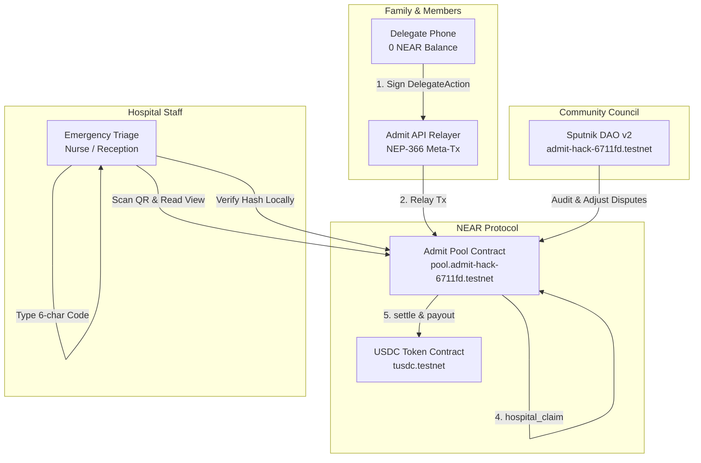
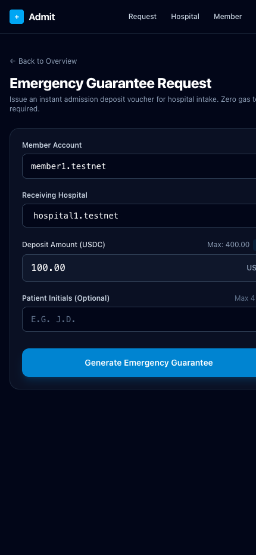
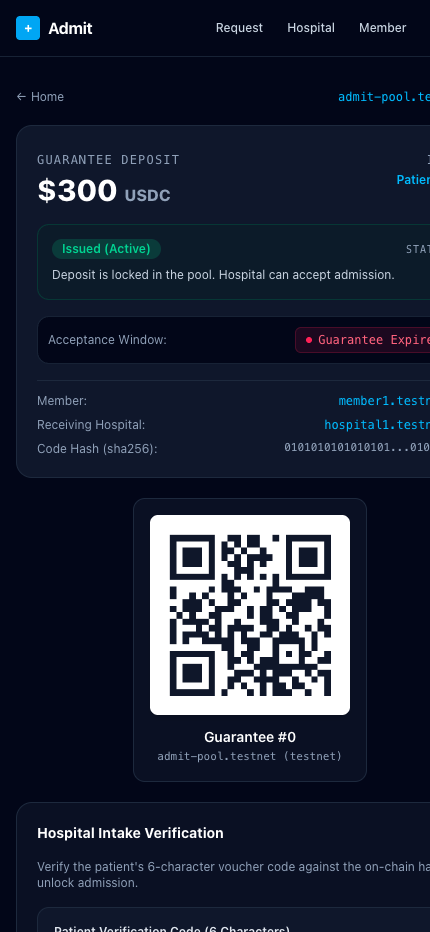
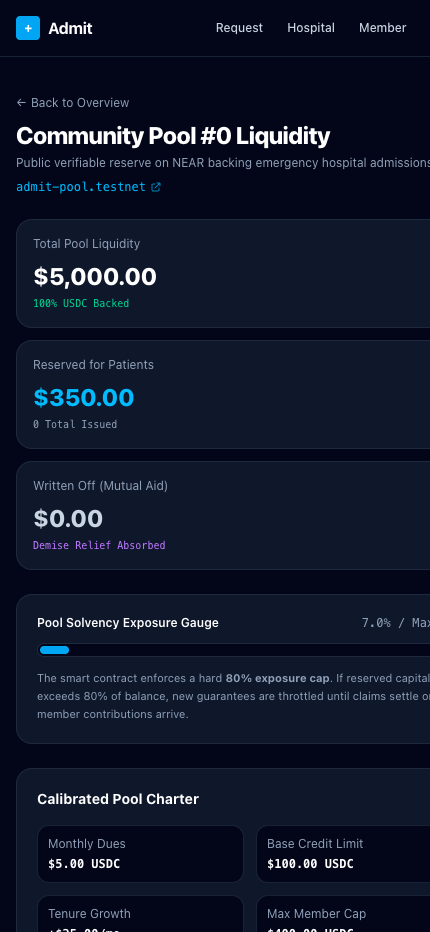
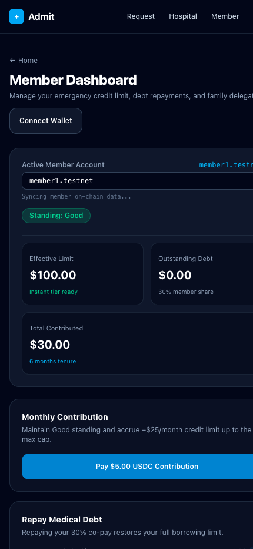
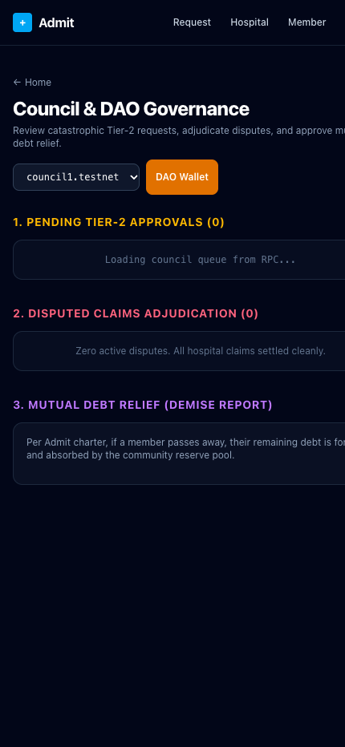
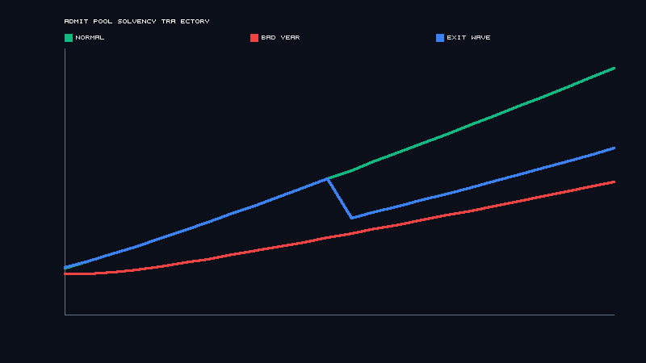

# Admit

**Instant hospital-deposit guarantees from community pools on NEAR — so emergency treatment starts before anyone pays.**

> Track: **Social Money** (Primary) · Real-World Money · Privacy & Private AI (Optional AI Module)  
> Multi-Project Disclosure: **N/A (Sole Entry)** — Admit is submitted as a standalone project entry.  
> Live plan and task tracking: [`ROADMAP.md`](ROADMAP.md) · Architecture: [`ARCHITECTURE.md`](ARCHITECTURE.md) · Essentials: [`ARCHITECTURE_ESSENTIALS.md`](ARCHITECTURE_ESSENTIALS.md)

---

## 1. What It Is & Problem Context

In much of sub-Saharan Africa and South Asia, private clinics and public hospitals routinely refuse emergency medical treatment until an upfront cash deposit is placed, and some detain patients who cannot settle bills:

- **Nigeria:** Pregnant women and trauma victims have died in triage waiting rooms while staff demanded cash deposits between ₦50,000 and ₦500,000 (~$38–$376) before doctors would touch them ([Sahara Reporters](https://saharareporters.com/2025/04/03/no-money-no-treatment-how-upfront-deposits-nigerian-hospitals-cost-lives-daniel-okonkwo), [Daily Trust](https://dailytrust.com/hospital-protocols-the-daily-battle-of-nigerians/)). Even high-profile patients—including a Nigerian senator requiring emergency care—have died when hospitals demanded upfront payment guarantees.
- **Detention for Non-Payment:** A Chatham House study estimated that hundreds of thousands of patients annually across at least 14 countries are detained in hospital wards due to unpaid bills.
- **The Core Insight:** Crowdfunding campaigns (e.g. GoFundMe) take 3–5 days to coordinate and cash out, but clinical emergencies kill within hours. Hospitals demand deposits because they fear non-payment. **What is urgently required is an instant, verifiable payment guarantee that hospital staff can confirm in under 2 minutes.**

**Admit** enables community circles (extended families, alumni associations, churches, market unions) to pre-fund pooled reserves. When an emergency strikes at 2:00 AM, a member or their paired delegate phone issues an on-chain deposit guarantee. Hospital reception staff simply scan a QR code and type a 6-character code to verify the guarantee on-chain and admit the patient immediately.

---

## 2. How It Works (The 2:04 AM Flow)



The system operates in 5 clear stages:

1. **2:04 AM — Emergency Guarantee Request:** A member's relative on a paired phone with zero NEAR triggers an admission guarantee ($300 USDC). The device signs an inner NEP-366 `DelegateAction` using its local function-call key; the Admit relayer wraps it and sponsors gas fees.
2. **2:06 AM — Instant Hospital Verification:** Hospital triage scans the requester's QR code. The verification page queries NEAR RPC views directly (zero hospital account or wallet login required). Staff enter the patient's 6-character code (`HVG34H`), which matches `sha256(code‖id)` on-chain. Staff tap **Accept Guarantee**, locking the status to `Accepted` and permanently stopping the expiration countdown. Emergency care begins immediately.
3. **Medical Treatment Provided:** The hospital delivers care with the certainty of guaranteed payment backed by the pool reserve.
4. **Post-Treatment Claim & Audit:** The hospital submits an itemized medical bill ($280 USDC). If a line item is contested, the member disputes within the dispute window. An advisory AI review (running in a confidential Intel TDX TEE) cross-checks line items against cited Ministry of Health benchmark tariffs, flagging redundant observation charges. The pool council audits the dispute and trims $30 USDC.
5. **Settlement & Credit Restoration:** The hospital receives $250 USDC. The member's debt increases by their mutual-aid share. When the member repays $50 USDC via NEP-141 `ft_transfer_call`, their debt decreases and their instant guarantee limit immediately recovers.

---

## 3. Visual Walkthrough & UI Screenshots

| 2:04 AM Emergency Request | Hospital QR Verification & Intake | Community Pool Dashboard |
|:---:|:---:|:---:|
|  |  |  |
| *Member triggers instant $300 guarantee from mobile with 0 NEAR* | *Triage nurse enters 6-char code; zero wallet required* | *Real-time pool balance, exposure cap, and active guarantees* |

| Member Credit & 1Click Top-Up | Council Dispute Audit & AI Review | Monte Carlo Solvency Simulation |
|:---:|:---:|:---:|
|  |  |  |
| *Revolving credit recovery + cross-chain 1Click deposits* | *Advisory TDX TEE medical bill review & trim* | *10,000-run Monte Carlo simulation: 0.00% insolvency* |

---

## 4. Quickstart — Do X, See Y

Follow these steps to run the complete workspace locally and execute the live testnet acceptance suite:

### Step 1: Clone and Install
```bash
git clone https://github.com/mallison031/admit.git
cd admit
pnpm install
```
*Expected output:* `Lockfile is up to date, resolution done, packages installed.`

### Step 2: Run All Tests
```bash
pnpm test
```
*Expected output:*
- Rust contract test suite: 133 unit tests and 38 integration tests pass (`test result: ok. 171 passed; 0 failed`).
- Shared core suite (`@admit/core`): 25 unit tests pass.
- API suite (`@admit/api`): 18 unit tests pass (relayer, allowlist, TEE bill check).
- Web suite (`@admit/web`): 20 component tests pass (Vitest jsdom).
- Scripts suite (`@admit/scripts`): 28 unit tests pass.

### Step 3: Verify Linter and Typechecks
```bash
pnpm lint
```
*Expected output:* `cargo fmt --all --check`, `cargo clippy`, `eslint`, and `tsc -b` pass with zero warnings or errors.

### Step 4: Seed Testnet State (Optional / Idempotent)
```bash
pnpm seed
```
*Expected output:* Verifies pool 0 (`St. Mark's Emergency Circle`), seeds 2 registered hospitals (`hospital1.testnet`, `hospital2.testnet`), and enrolls members with calibrated credit limits.

### Step 5: Execute the 2:04 AM Acceptance Test
```bash
pnpm demo
```
*Expected output:* Executes all 7 PRD §8 acceptance steps (seed check → emergency guarantee → triage intake verification → medical claim & audit trim → debt repayment & limit recovery → abuse attack denial → Monte Carlo solvency verification) in under 5 minutes (< 3 seconds in simulated mode), printing NearBlocks explorer links and generating `docs/demo.md`.

### Step 6: Start Web Portal
```bash
pnpm --filter @admit/web dev
```
*Expected output:* Next.js local server running on `http://localhost:3000`. Navigate to `/g/0` to test the hospital QR intake interface directly.

---

## 5. Limitations & Threat Model Summary

### Design & Regulatory Limitations
- **Mutual-Aid Credit Line, Not Insurance:** Admit operates as a community mutual-aid credit facility with revolving credit limits and member repayments. The community reserve absorbs claims only upon certified death (`report_death`) or explicit council write-off (`council_write_off`). Real-world deployments require formal legal structuring under local mutual aid or credit cooperative frameworks (e.g., NAICOM regulations in Nigeria).
- **Fiat Off-Ramp Dependency:** Hospitals ultimately disburse expenses in local fiat (e.g. Nigerian Naira ₦). Settlements occur on-chain in NEP-141 USDC; participating clinics utilize licensed local payment rails or P2P off-ramps for conversion.
- **Hospital Network Adoption:** Emergency guarantees require hospitals registered by the pool DAO. Unregistered hospitals cannot claim funds.

### Threat Model & Mitigations
| Threat Vector | Potential Vulnerability | Admit On-Chain Mitigation |
|---|---|---|
| **Hit-and-Run Claims** | Brand-new member requests maximum guarantee and leaves. | Enforces `min_tenure_months` + contribution history (`E07_TENURE_TOO_SHORT`, `E08_CONTRIBUTIONS_UNPAID`). |
| **Serial Claim Abuse** | Member initiates multiple large claims concurrently. | Enforces `max_active_guarantees` cap (2) and mandatory cooldown period (`E09_TOO_MANY_ACTIVE`, `E10_COOLDOWN`). |
| **Inflated Hospital Bills** | Clinic charges exorbitant rates for emergency procedures. | Claim cannot exceed guarantee (`E15`); mandatory member dispute window (`E16`); advisory TEE benchmark review; council adjustment authority. |
| **Run on the Pool** | Multiple concurrent emergencies drain pool reserves. | Strict pool exposure cap: `reserved + amount <= pool_balance * max_exposure_bps` (`E13_EXPOSURE_CAP`). Verified solvent ($P < 5\%$) across 10,000 Monte Carlo runs (see `docs/simulation/summary.md`). |
| **Key Theft / Compromise** | Stolen delegate or hospital device key executes unauthorized calls. | Function-call keys restricted strictly to relayer allowlist (`request_guarantee`, `hospital_accept`, `hospital_claim`, etc.). Full access keys never stored on client devices. |

---

## 6. Libraries & Technology Stack

Every dependency was vetted against NEAR testnet/mainnet compatibility:

| Component | Library / Package | Version | Purpose & Rationale |
|---|---|---|---|
| **Smart Contract** | `near-sdk` | `5.30.0` | Rust SDK for NEAR smart contracts, supporting protocol version 88 and embedded ABI metadata. |
| **Standards** | `near-contract-standards` | `5.30.0` | NEP-141 fungible token, NEP-145 storage management, and NEP-297 event logging. |
| **Integration Tests** | `near-workspaces` | `0.24.0` | Sandboxed local NEAR blockchain harness for multi-contract testing. |
| **Frontend** | `next` | `16.4.4` | React 19 framework with Tailwind CSS v4, supporting fast mobile rendering. |
| **Blockchain RPC** | `near-api-js` | `7.4.0` | TypeScript NEAR SDK for view calls, NEP-366 `DelegateAction` meta-transactions, and ed25519 key management. |
| **Backend API** | `hono` | `4.13.16` | High-performance edge/Node API router for relayer submission, device onboarding, and TEE bill checks. |
| **Schema Validation** | `zod` | `4.6.7` | Runtime type safety and schema validation across core contracts, API requests, and env variables. |
| **Testing** | `vitest` | `5.1.0` | Fast browser/jsdom component unit testing for React frontend components. |

### AI Disclosure
Per NEAR Hackathon rules regarding AI-assisted development:
- All high-level architecture, cryptographic protocols, tokenomics, state machine transitions, and error codes were designed and specified by the human project author (Allison).
- Code generation tools were utilized for boilerplate scaffolding, test fixture population, and unit test generation under continuous human review, manual architectural verification, and end-to-end sandbox audit.
- In compliance with repository requirements, git commit history contains zero AI attribution tags.

---

## 7. Contributing & Repository Structure

- Codebase follows the project structure documented in [`project_structure.md`](project_structure.md).
- Architectural invariants are detailed in [`ARCHITECTURE.md`](ARCHITECTURE.md) and [`ARCHITECTURE_ESSENTIALS.md`](ARCHITECTURE_ESSENTIALS.md).
- Development rules and constraints are detailed in [`AGENTS.md`](AGENTS.md).
- Progress and issue tracking: [`ROADMAP.md`](ROADMAP.md) and [`docs/ISSUES.md`](docs/ISSUES.md).

---

## 8. License

MIT License — see [`LICENSE`](LICENSE).
